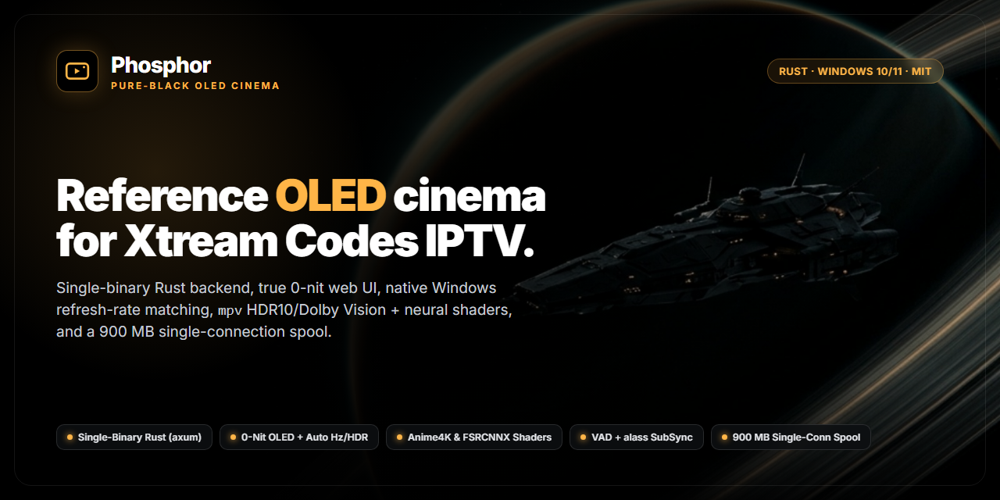
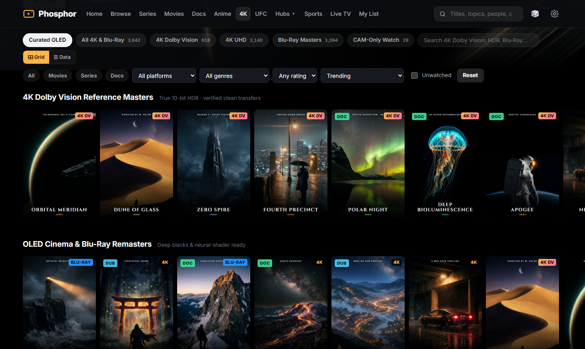
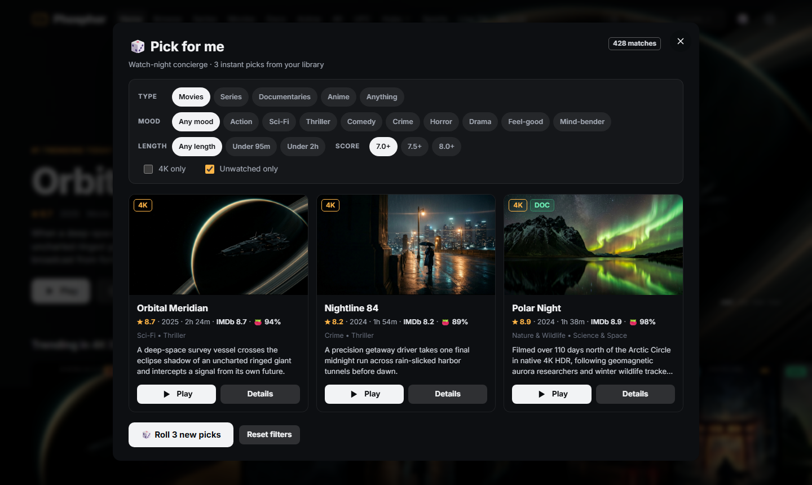
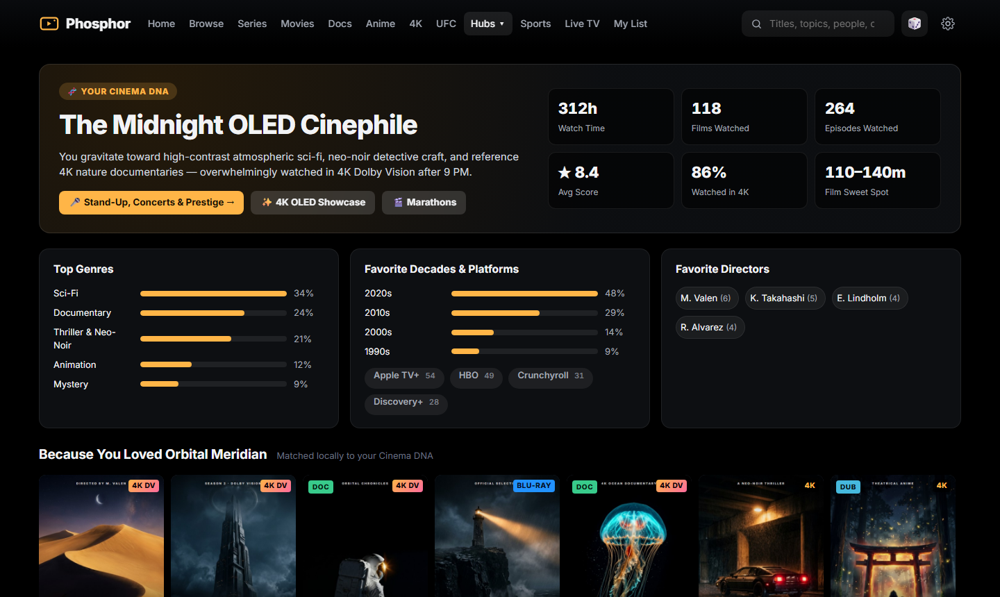
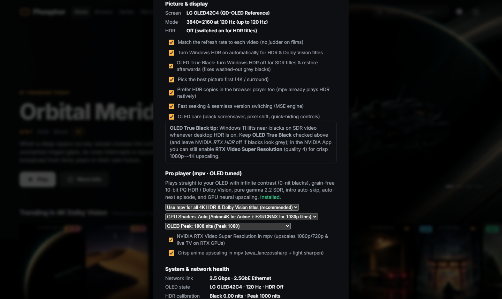
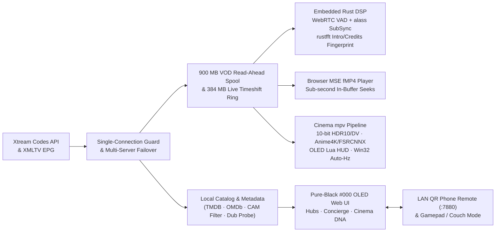

<div align="center">



<br />

[-ffb547?style=for-the-badge&logo=rust&logoColor=000000)](server/Cargo.toml)
[](#installation)
[](https://github.com/TPZZ759/phosphor/actions/workflows/ci.yml)
[](LICENSE)
[](https://github.com/TPZZ759/phosphor/stargazers)

<h3>Reference pure-black OLED cinema for Xtream Codes IPTV.</h3>

<p>
  <strong>Single-binary Rust backend</strong> · <strong>0-nit OLED web UI</strong> · <strong>Native Windows Hz &amp; HDR switching</strong><br />
  <strong><code>mpv</code> HDR10/Dolby Vision + Anime4K/FSRCNNX shaders</strong> · <strong>900 MB single-connection spool</strong> · <strong>Embedded VAD + <code>alass</code> subtitle sync</strong>
</p>

<p>
  <a href="#-install-in-60-seconds-with-ai">Install with AI</a> ·
  <a href="#screenshots">Screenshots</a> ·
  <a href="#why-phosphor">Why Phosphor?</a> ·
  <a href="#features">Features</a> ·
  <a href="#architecture">Architecture</a> ·
  <a href="#keyboard-shortcuts">Shortcuts</a>
</p>

</div>

> **Player-Only Disclaimer:** Phosphor is an open-source, provider-agnostic **media player front-end only**. It does **not** include, host, endorse, link to, or distribute any streams, playlists, channels, or copyrighted media. You must supply your own Xtream Codes credentials from a legitimate provider.

---

## ⚡ Install in 60 Seconds with AI

Phosphor ships with an [`AGENTS.md`](AGENTS.md) setup spec written specifically for AI coding agents (**Claude Code, Codex, Cursor, Windsurf, Antigravity, Cline**). Paste this into your agent:

```text
Clone https://github.com/TPZZ759/phosphor, read AGENTS.md, install any missing Windows prerequisites (Rust, FFmpeg, mpv), run setup.ps1, ask me for my Xtream Codes credentials and optional free TMDB API key to configure config.json, then launch Phosphor and verify http://127.0.0.1:7878/api/status is responding.
```

Prefer manual setup or a prebuilt binary? Jump to **[Manual Installation](#installation)**.

---

## Screenshots

<p align="center">
  
  <br />
  <em>Pure <code>#000000</code> OLED home screen with full-bleed hero banners, 4K Dolby Vision badges, and zero UI clutter.</em>
</p>

<table align="center">
  <tr>
    <td align="center" width="50%">
      <br />
      <strong>4K OLED Showcase &amp; CAM-Free Classifier (<code>#/4k</code>)</strong><br />
      <sub>Automatic CAM/Telesync filtering, 4K DV / 4K UHD / Blu-Ray tiers &amp; upgrade alerts</sub>
    </td>
    <td align="center" width="50%">
      <br />
      <strong>Documentaries Hub — <code>☰ Data</code> View (<code>#/docs</code>)</strong><br />
      <sub>9 auto-classified topics, IMDb/RT scores, probed bitrate + HDR badges &amp; faceted filters</sub>
    </td>
  </tr>
  <tr>
    <td align="center" width="50%">
      <br />
      <strong>Watch-Night Concierge (<code>🎲</code>)</strong><br />
      <sub>Filter by type, mood, length, rating, 4K &amp; unwatched for 3 instant non-repeating picks</sub>
    </td>
    <td align="center" width="50%">
      <br />
      <strong>Personal Cinema DNA (<code>#/dna</code>)</strong><br />
      <sub>100% local watch analytics, deterministic taste persona, genres, decades &amp; directors</sub>
    </td>
  </tr>
  <tr>
    <td align="center" width="50%">
      <br />
      <strong>OLED True Black, Shaders &amp; Display Health</strong><br />
      <sub>Native Win32 refresh-rate matching, SDR HDR-off fix, ICC 0.00-nit black-floor detector &amp; RTX VSR</sub>
    </td>
    <td align="center" width="50%">
      <br />
      <strong>QR-Paired Wi-Fi Phone Remote (<code>:7880</code>)</strong><br />
      <sub>Zero-app mobile PWA for seek, skip intro, subtitles, audio tracks, versions &amp; D-pad navigation</sub>
    </td>
  </tr>
</table>

---

## Why Phosphor?

Most desktop IPTV apps are sluggish Electron wrappers with flat folder trees, broken single-connection handling, and washed-out SDR-in-HDR grey blacks on OLED monitors. Phosphor was engineered from scratch in **Rust + vanilla JS + Lua** to feel like a dedicated reference home-theater appliance.

| Capability | Phosphor | Typical Desktop IPTV Clients |
|---|---|---|
| **Runtime & Footprint** | Single compiled Rust binary (`axum`/`tokio`) + zero-build vanilla JS | Heavy Electron / Chromium shells |
| **Single-Connection Safety** | Preflight guard, instant stream handoff, **900 MB** VOD read-ahead spool, **384 MB** Live MPEG-TS timeshift ring | Duplicate-connection kicks & seek stalls |
| **OLED Picture Pipeline** | Native Win32 `QueryDisplayConfig` Hz matching (`24/25/30/50/60 Hz`), auto SDR HDR-off true 0-nit blacks, Windows ICC black-floor diagnostic, `mpv` 10-bit `libplacebo` HDR10/DV | 60 Hz judder & lifted grey blacks on Windows 11 HDR |
| **GPU Neural Upscaling** | Bundled `Anime4K` (Fast/HQ), `FSRCNNX`, `KrigBilateral` live-switchable (`Ctrl+0–3`) + optional NVIDIA RTX VSR | Basic bilinear scaling |
| **Subtitles** | Embedded **WebRTC VAD + `alass`** automatic speech alignment, zero-key OpenSubtitles search, **`R` "What Did They Just Say?"** 8s rewind with temporary EN subs | Manual timing offsets & external downloads |
| **Intro, Credits & Filler** | Local Rust FFT (`rustfft`) audio-fingerprinted intro/credits skip + Anime Filler badges & auto-skip | Manual scrubbing |
| **Discovery & Curation** | 4K CAM-Free Showcase, 9-topic Docs Hub, Dub-verified Anime Hub, 15 Franchise Marathons (Chrono/Release), Release Radar, Cinema DNA, Watch-Night Concierge | Endless raw provider folder lists |
| **Living-Room Ecosystem** | QR Wi-Fi Phone Remote, Gamepad/Couch Mode, DLNA Casting, Two-way Trakt, Letterboxd `.zip` import, Windows Tray + dynamic global media keys | Mouse-only window |

---

## Architecture



---

## Features

### Armored Streaming & Playback Engine
- **Built for single-connection accounts:** Connection preflight guard, automatic stream handoff, background worker yielding, and a **900 MB in-memory VOD read-ahead spool** so seeks and brief network blips never stall playback or trigger duplicate connections.
- **Fast Browser Player (MSE fMP4):** Sub-second in-buffer seeks, seamless quality/version switching, automatic failover across alternate copies, and source health tracking.
- **Live TV Timeshift & Guide:** **384 MB** live MPEG-TS ring buffer (pause, rewind, and jump back to live), multi-feed channel deduplication, XMLTV TV Guide + Catch-up, **in-player Mini-Guide & Live Scores drawer (`G`)**, and broadcast reminders.
- **Self-Correcting Subtitles:** Embedded subtitle extraction plus free zero-key OpenSubtitles search directly inside the player, automatically speech-aligned in Rust via **`webrtc-vad` + `alass-core`**.
- **Audio-Fingerprinted Intro & Credits Skip:** Local **`rustfft`** acoustic fingerprinting detects show intros and end credits for automatic Skip Intro (`S`) and Up Next episode countdowns.
- **"What Did They Just Say?" (`R`):** Rewinds 8 seconds and temporarily turns on English subtitles — works identically in both the browser player and `mpv`.

### Reference OLED & Cinema `mpv` Pipeline
- **OLED True Black Pipeline:** Native Windows `QueryDisplayConfig` / `ChangeDisplaySettingsEx` refresh-rate matching (`24/25/30/50/60 Hz` multiples), automatic Windows HDR toggle (including turning HDR *off* for SDR video to eliminate Windows 11's lifted grey blacks), and automatic display restore on exit.
- **Built-in Display & Network Health Diagnostics:** Automatically parses your active Windows HDR Calibration `.icc` profile to warn if the black floor is raised above `0.00 nits`, and flags Ethernet adapters stuck below Gigabit speeds.
- **Custom Pure-Black OLED Lua HUD (`mpv-scripts/tv_osd.lua`):** Cinema controls, live Clear Voice / Night Mode (`dynaudnorm`), Skip Intro (`S`), clickable Up Next, auto black-bar crop (`B`), and 8s replay with subs (`R`).
- **GPU Neural Upscaling Shaders (`mpv-shaders/`):** Bundled `Anime4K` (Fast & HQ), `FSRCNNX`, and `KrigBilateral` GLSL shader chains switchable live with `Ctrl+0–3`, plus optional **NVIDIA RTX Video Super Resolution**.

### Rich Discovery, Curation & Specialized Hubs
- **4K OLED Showcase & CAM Watch (`#/4k`):** Bulletproof CAM/Telesync detector keeps discovery rows clean, classifies **4K Dolby Vision / 4K UHD / Blu-Ray** masters, and watches for quality upgrades.
- **Dedicated Documentaries Hub (`#/docs`):** Auto-classifies documentary films and series across **9 topics** (*Nature & Wildlife, Science & Space, True Crime, History & War, Sports, Biography, Music & Arts, Society & Culture, Food & Travel*) with full faceted filtering.
- **English-Dubbed Anime Hub (`#/anime`):** Episode-level audio track verification (`ffprobe` cache), automatic hiding of sub-only episodes, **"Notify when dubbed"** alerts, and **Anime Filler Badges** (`FILLER` / `MIXED`) with automatic **Skip Filler**.
- **Marathons & Franchise Watch Order (`#/marathons`):** 15 curated bingeable franchises with toggleable **Chronological Story Order** and **Theatrical Release Order**, live library matching, and Next-Up progress tracking.
- **Personal Cinema DNA (`#/dna`) & Specialty Hubs (`#/specials`):** Local viewing stats, taste persona, favorite directors/decades, plus dedicated hubs for Stand-Up Comedy, Live Concerts, World Cinema, and Under-95m Tight Bangers.
- **Release Radar (`#/radar`) & Sports / Replays (`#/sports`, `#/fights`):** Digital-drop calendar, live ESPN scoreboards with team kickoff alerts, and spoiler-free combat sports replays.
- **Deep Faceted Browse & `⊞ Grid` / `☰ Data` Toggle:** Filter across `ANY/ALL` genres, platforms, countries, vote tiers, runtime, and series status, or hit **`🎲` Watch-Night Concierge** for 3 instant picks.

### Living-Room Controls, Remote & Sync
- **Wi-Fi Phone Remote (`:7880`):** Off by default; enable in Settings to scan a generated QR code and control seek, subtitles, audio tracks, versions, and D-pad navigation from any phone browser.
- **Couch & Gamepad Mode:** Full arrow-key and Xbox/PlayStation controller spatial navigation (`TV Mode`).
- **Sync & Casting:** Two-way **Trakt** sync, **Letterboxd `.zip`** import, **DLNA** Smart TV casting, and a lightweight Windows system tray companion that dynamically binds global hardware media keys *only* while `mpv` is playing.

---

## Installation

### Prerequisites (Windows 10 / 11 64-bit)
- **FFmpeg (`ffmpeg` & `ffprobe`)** on `PATH`:
  ```powershell
  winget install Gyan.FFmpeg
  ```
- **mpv** *(optional, strongly recommended for 4K HDR10 / Dolby Vision & neural shaders)*:
  ```powershell
  winget install shinchiro.mpv
  ```
- **Rust toolchain** *(only if building from source — skip if using a GitHub Release `.zip`)*: https://rustup.rs/

### Option A: Prebuilt Release (Fastest Manual Setup)
1. Download `Phosphor-windows-x64.zip` from **[GitHub Releases](https://github.com/TPZZ759/phosphor/releases)** and extract it.
2. Copy `config.example.json` to `config.json` and fill in your Xtream Codes credentials.
3. Double-click **`Open Phosphor.vbs`**.

### Option B: Build from Source
```powershell
git clone https://github.com/TPZZ759/phosphor.git
cd phosphor
powershell -ExecutionPolicy Bypass -File .\setup.ps1
```
`setup.ps1` checks prerequisites, compiles `phosphor-server.exe` in release mode, stages the Windows launchers, and creates `config.json` from `config.example.json`.

### Configuration (`config.json`)
```json
{
  "servers": ["http://your-provider-host.example"],
  "username": "YOUR_USERNAME",
  "password": "YOUR_PASSWORD",
  "port": 7878,
  "tmdbKey": "OPTIONAL_FREE_TMDB_API_KEY",
  "omdbKey": "",
  "serverTimezone": "Europe/Amsterdam",
  "mpvPath": "C:\\Program Files\\MPV Player\\mpv.exe",
  "catalogRefreshHours": 12
}
```
- **TMDB API key (free, strongly recommended):** https://www.themoviedb.org/settings/api — unlocks Trending rows, Cinema DNA, Marathons, Release Radar, and rich faceted search (can also be pasted in **Settings**).
- **OMDb API key (free, optional):** https://www.omdbapi.com/apikey.aspx — adds IMDb, Rotten Tomatoes, and Metacritic badges.

### Launch
- **`Open Phosphor.vbs`** — Starts `phosphor-server.exe` hidden on `http://localhost:7878` and opens Phosphor in a clean frameless app window.
- **`Start Phosphor Tray.vbs`** *(optional)* — Lightweight Windows system tray companion with dynamic global media keys and logon auto-start toggle.
- **`Stop Phosphor.cmd`** — Stops the background server anytime.

---

## Keyboard Shortcuts

| Context | Key | Action |
|---|---|---|
| Navigation | `Arrows` / `Enter` / `Backspace` | Spatial couch / gamepad navigation |
| Navigation | `/` | Focus global search |
| Player (Browser & `mpv`) | `Space` / `K` | Play / Pause (pauses Live TV ring buffer too) |
| Player (Browser & `mpv`) | `←` / `→` | Seek ±10 seconds |
| Player (Browser & `mpv`) | `R` | **"What did they just say?"** (8s rewind with temporary EN subs) |
| Player (Browser & `mpv`) | `S` | Skip Intro |
| Player (Browser & `mpv`) | `C` | Toggle / cycle subtitles |
| Player (Browser & `mpv`) | `N` | Next episode |
| Player (Browser & `mpv`) | `F` / `M` / `I` | Fullscreen / Mute / Playback stats overlay |
| Browser Player | `P` | Hand off current title directly to `mpv` |
| Browser Player | `G` / `H` | Subtitle timing ±250 ms (`G` opens Mini-Guide on Live TV) |
| Browser Player | `[` / `]` | Audio timing ±100 ms |
| `mpv` OLED HUD | `B` | Auto-crop black bars (`cropdetect`) |
| `mpv` OLED HUD | `Ctrl+0` / `1` / `2` / `3` | Live GPU shaders: Off / Film (`FSRCNNX`) / `Anime4K` Fast / `Anime4K` HQ |
| Live TV | `G` / `L` / `↑↓` / `End` | Mini-Guide & Live Scores / Last Channel / Zap / Jump to Live |

---

## Project Layout

```text
├── AGENTS.md                  # Deterministic setup contract for AI coding agents
├── setup.ps1                  # One-command Windows build & staging script
├── config.example.json        # Config template (copy to config.json; gitignored)
├── server/                    # Single-binary Rust backend (axum, tokio, webrtc-vad, alass, rustfft)
│   ├── Cargo.toml
│   ├── Cargo.lock
│   ├── deploy-when-idle.ps1   # Zero-interruption idle server binary swapper
│   └── src/
├── public/                    # Zero-build vanilla JS + pure-black OLED CSS UI & mobile remote
├── mpv-scripts/               # Custom pure-black OLED Lua OSD (tv_osd.lua)
├── mpv-shaders/               # Bundled GLSL neural shaders + third-party licenses
├── scripts/                   # Windows launchers, watchdog & amber-icon tray companion
└── docs/assets/               # Brand mark, banner & clean synthetic UI showcase screenshots
```

## License

MIT — see [LICENSE](LICENSE). Third-party GLSL shaders in `mpv-shaders/` carry their own upstream licenses (see [mpv-shaders/THIRD_PARTY_LICENSES.md](mpv-shaders/THIRD_PARTY_LICENSES.md)).
