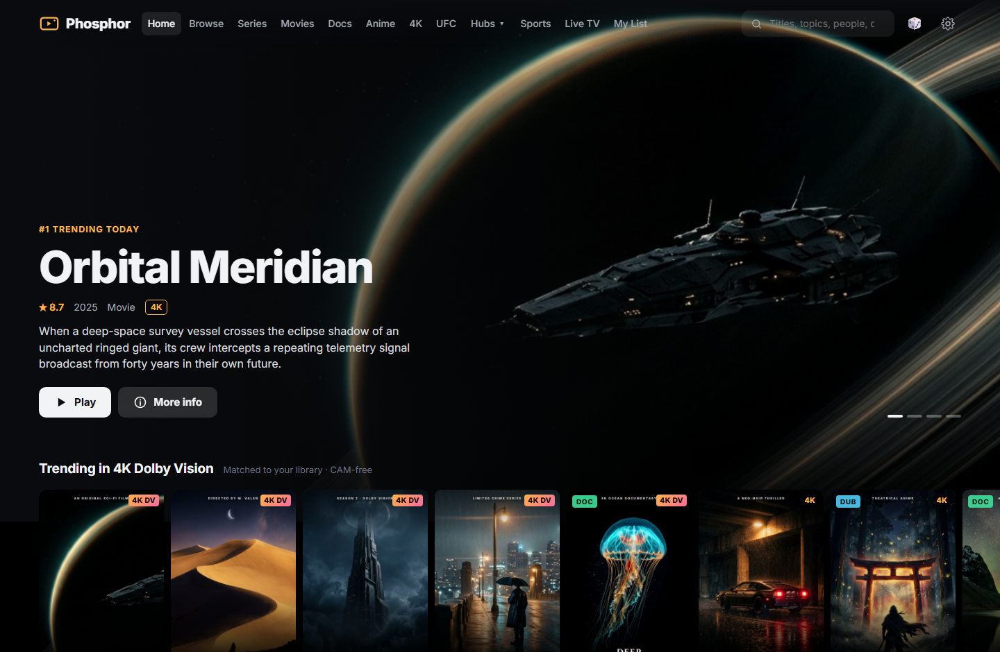
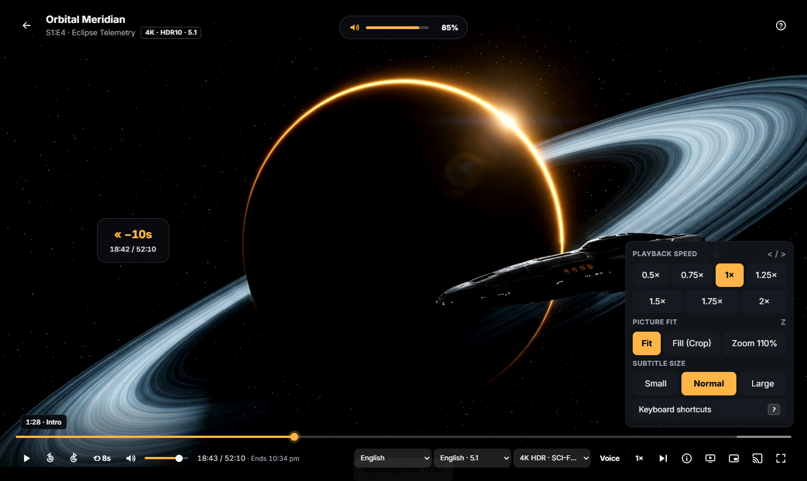
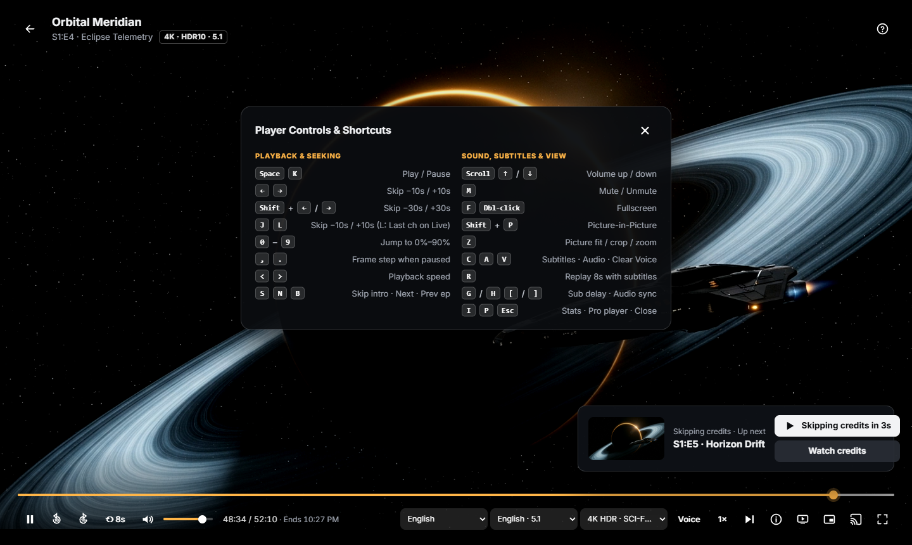
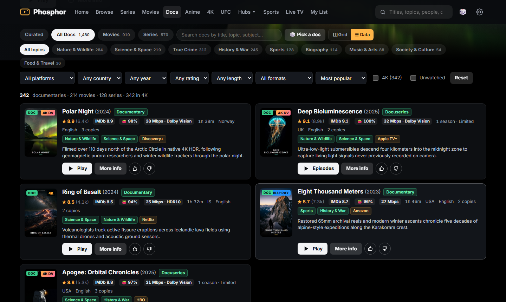
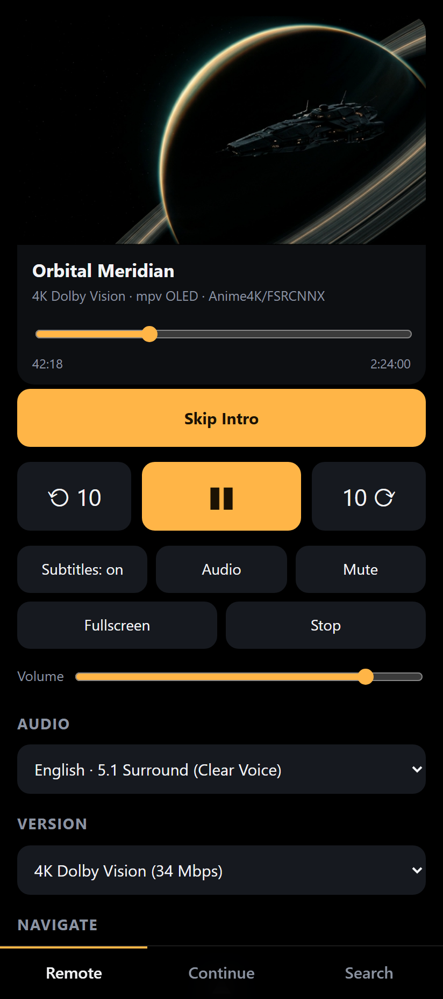
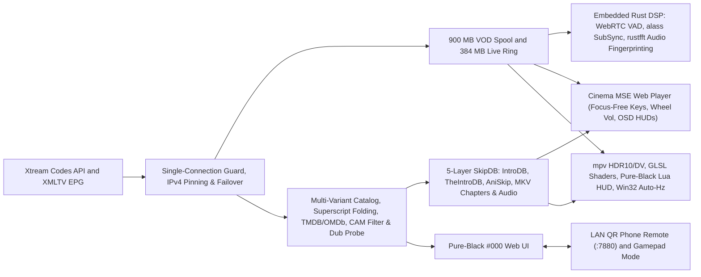

<div align="center">


<br />

[-ffb547?style=for-the-badge&logo=rust&logoColor=000000)](server/Cargo.toml)
[](#manual-installation)
[](https://github.com/TPZZ759/phosphor/actions/workflows/ci.yml)
[](https://github.com/TPZZ759/phosphor/releases)
[](LICENSE)

<p>
  Phosphor is a local Windows streaming front-end for Xtream Codes IPTV accounts. A single Rust binary serves a pure-black OLED web interface and keyboard-first MSE browser player, controls mpv for HDR10 and Dolby Vision playback with neural shaders, matches Windows display refresh rates through Win32 APIs, auto-skips recaps, intros, and credits across 5 detection layers, and buffers streams in memory so single-connection accounts do not stall or disconnect.
</p>

<p>
  <a href="#install-with-an-ai-agent">Install with AI</a> |
  <a href="#screenshots">Screenshots</a> |
  <a href="#why-phosphor">Why Phosphor</a> |
  <a href="#architecture">Architecture</a> |
  <a href="#manual-installation">Manual setup</a> |
  <a href="#keyboard-and-mouse-shortcuts">Shortcuts</a>
</p>

</div>

> Phosphor is a media player client only. It does not include, host, link to, or distribute streams, playlists, channels, or copyrighted media. You must provide your own Xtream Codes credentials from a legitimate provider.

---

## Install with an AI agent

This repository includes [AGENTS.md](AGENTS.md) with the exact prerequisite commands, build steps, configuration schema, and health check for coding agents such as Claude Code, Codex, Cursor, Windsurf, Cline, and Antigravity. Paste this prompt into your agent:

```text
Clone https://github.com/TPZZ759/phosphor, read AGENTS.md, install any missing Windows prerequisites (Rust, FFmpeg, mpv), run setup.ps1, ask me for my Xtream Codes credentials and optional free TMDB API key to write config.json, then launch Phosphor and verify http://127.0.0.1:7878/api/status returns a response.
```

You can also download a prebuilt Windows zip from [GitHub Releases](https://github.com/TPZZ759/phosphor/releases) or build from source in [Manual installation](#manual-installation).

---

## Screenshots

<p align="center">
  
  <br />
  <em>Pure <code>#000000</code> OLED home view with widescreen heroes and 4K Dolby Vision badges.</em>
</p>

<table align="center">
  <tr>
    <td align="center" width="50%">
      <br />
      <strong>Cinema browser player (MSE + OSD HUDs)</strong><br />
      <sub>0 ms in-buffer seeks, drag-to-scrub with Intro/Credits markers, scroll-wheel volume HUD, Ends-at clock, playback speed, Picture Fit/Crop, subtitle size, and Picture-in-Picture.</sub>
    </td>
    <td align="center" width="50%">
      <br />
      <strong>5-layer auto-skip &amp; focus-free shortcuts (<code>?</code>)</strong><br />
      <sub>IntroDB, TheIntroDB, AniSkip, MKV chapters, and local acoustic fingerprinting drive automatic recap/intro skipping, 3 s credits auto-next, and capture-phase shortcuts that work from anywhere.</sub>
    </td>
  </tr>
  <tr>
    <td align="center" width="50%">
      <br />
      <strong>4K OLED catalog and CAM filter (<code>#/4k</code>)</strong><br />
      <sub>Filters CAM and Telesync rips, ranks 4K Dolby Vision, 4K HDR, 4K Dolby Audio, and Blu-Ray copies, rescues cross-market 4K upgrades with an English-audio safety gate, and tracks upgrades.</sub>
    </td>
    <td align="center" width="50%">
      <br />
      <strong>Documentaries hub in data view (<code>#/docs</code>)</strong><br />
      <sub>Classifies documentaries into 9 topics and displays IMDb scores, Rotten Tomatoes scores, probed bitrate, and HDR tags.</sub>
    </td>
  </tr>
  <tr>
    <td align="center" width="50%">
      <br />
      <strong>Watch-night picker</strong><br />
      <sub>Filters by media type, mood, runtime, minimum score, 4K availability, and unwatched status to return 3 non-repeating picks.</sub>
    </td>
    <td align="center" width="50%">
      <br />
      <strong>Local Cinema DNA (<code>#/dna</code>)</strong><br />
      <sub>Computes watch hours, genre weights, decade distribution, 4K share, and favorite directors locally on disk.</sub>
    </td>
  </tr>
  <tr>
    <td align="center" width="50%">
      <br />
      <strong>OLED display and shader controls</strong><br />
      <sub>Matches refresh rate via Win32, disables Windows HDR for SDR video, inspects your Windows HDR ICC profile for a 0.00 nit floor, and toggles mpv neural shaders.</sub>
    </td>
    <td align="center" width="50%">
      <br />
      <strong>QR-paired Wi-Fi phone remote (<code>:7880</code>)</strong><br />
      <sub>Browser remote on your LAN for seeking, skipping intros, switching audio tracks and stream versions, and directional navigation.</sub>
    </td>
  </tr>
</table>

---

## Why Phosphor

Most desktop IPTV clients wrap a web player in Electron, leave provider folders flat, open duplicate connections during seeks, trap keyboard shortcuts on buttons, and play 24 fps SDR video inside a 60 Hz Windows HDR desktop where blacks turn dark grey on OLED panels. Phosphor replaces that stack with a compiled Rust server, vanilla HTML/CSS/JS, a keyboard-first MSE browser player, and an OLED-calibrated mpv pipeline.

| Area | Phosphor | Typical desktop IPTV clients |
|---|---|---|
| Runtime | One Rust binary (`axum`, `tokio`) and static vanilla JS without a build step | Electron or heavy Chromium wrappers |
| Single-connection handling | Preflight lock, IPv4-pinned clients, 900 MB in-memory VOD read-ahead spool, and 384 MB Live MPEG-TS ring buffer | Duplicate-connection kicks and seek stalls |
| Browser cinema player | Focus-anywhere capture-phase keyboard, scroll-wheel volume HUD, 0 ms MSE in-buffer seeks, drag-to-scrub with Intro/Credits markers, playback speed (`0.5×–2×`), Picture Fit/Crop, PiP, and Ends-at clock | Basic `<video>` controls that lose keyboard focus after every click |
| Universal auto-skip & auto-next | 5-layer engine (IntroDB, TheIntroDB, AniSkip, MKV chapters, `rustfft` audio fingerprinting), recap + intro auto-skip, 3 s fast credits countdown, and zero-race `mpv` auto-next | Manual scrubbing every episode |
| Catalog & quality engine | Unicode superscript folding, parallel multi-variant episode merging, cross-market 4K/HDR/Dolby Audio attachment with automatic English-audio fallback, CAM blocker, and decaying source health | Duplicate folders, missing episodes, and broken 4K tags |
| OLED picture accuracy | Win32 `QueryDisplayConfig` refresh-rate matching (`24`, `25`, `30`, `50`, `60 Hz`), automatic Windows HDR off for SDR video, ICC black-floor check, and mpv 10-bit `libplacebo` HDR10/Dolby Vision | 60 Hz judder and raised SDR blacks under Windows 11 HDR |
| GPU upscaling | Bundled `Anime4K` Fast/HQ, `FSRCNNX`, and `KrigBilateral` shaders toggled live with `Ctrl+0`, `1`, `2`, `3`, plus optional NVIDIA RTX Video Super Resolution | Bilinear scaling |
| Subtitles | Embedded `webrtc-vad` and `alass-core` automatic speech alignment, zero-key OpenSubtitles search, and `R` for an 8 second rewind with temporary English subtitles | Manual offset adjustments |
| Couch controls and sync | QR-paired LAN phone remote, gamepad navigation, DLNA casting, two-way Trakt sync, Letterboxd zip import, and a Windows tray companion with dynamic global media keys | Mouse-only window |

---

## Architecture



---

## Streaming and playback engine

- **Single-connection protection.** A preflight guard closes the active upstream socket before opening a new stream, background probes pause during playback, all upstream HTTP clients pin IPv4 so VPNs never split sessions across IPv4/IPv6, and a 900 MB in-memory read-ahead spool absorbs seeks and brief drops without reconnecting.
- **Keyboard-first MSE browser cinema player.** The Rust server remuxes VOD streams to fragmented MP4 on the fly for 0 ms in-buffer seeks, 220 ms batched out-of-buffer seeks, seamless version switching, and automatic copy failover. Global capture-phase keyboard shortcuts and scroll-wheel volume work regardless of which button or menu was clicked last, backed by translucent Seek/Volume/Play HUDs, drag-to-scrub with buffered progress and Intro/Recap/Credits timeline markers, clickable Remaining Time + `Ends at` finish clock, playback speed (`0.5×–2×`), Picture Fit/Crop/Zoom, Subtitle Size, Picture-in-Picture, and an in-player `?` shortcut sheet.
- **5-layer universal auto-skip & auto-next.** Combines MKV chapter markers, crowd-sourced databases (**IntroDB**, **TheIntroDB v2**, and **AniSkip/ARM** — zero IPTV connections), and local `rustfft` acoustic fingerprinting with E+1..E+3 episode prefetching. Automatically skips recaps and intros, triggers a fast 3-second credits auto-next (with a one-click "Watch credits" cancel), and uses exit-code handoff in `mpv` for zero-race binge transitions.
- **Multi-variant catalog & stream quality engine.** Folds Unicode superscript tags (`⁴ᴷ`, `ᴰᵒˡᵇʸ ⱽᶦˢᶦᵒⁿ`, `ᴰᴼᴸᴮʸ ᴬᵁᴰᴵᴼ`) cleanly into ASCII to prevent 4K/HD collisions across VOD and Live TV, merges seasons and episodes across all English series variants in parallel, attaches clean cross-market 4K/HDR/Dolby Audio movie and series upgrades with an automatic English-audio probe safety gate, ranks `4K Dolby Vision > 4K HDR > 4K Dolby Audio > 4K > Blu-Ray > HD > CAM`, and uses decaying per-source health telemetry so one temporary hiccup never permanently demotes a 4K copy.
- **Live TV timeshift and EPG.** A 384 MB MPEG-TS ring buffer lets you pause, rewind, and jump back to live. Phosphor deduplicates duplicate feeds (ranking 4K UHD and RAW 50/60fps streams first), loads XMLTV guides and catch-up archives, and opens a live mini-guide and sports scoreboard drawer when you press `G`.
- **Automatic speech-aligned subtitles & 8 s dialogue replay.** Phosphor extracts embedded subtitle tracks and searches OpenSubtitles without an API key, aligns cues against decoded speech using compiled-in `webrtc-vad` and `alass-core`, and rewinds 8 seconds with temporary English subtitles whenever you press `R` in either player.

## OLED display and mpv pipeline

- **Automatic refresh-rate and HDR switching.** Phosphor calls Windows `QueryDisplayConfig` and `ChangeDisplaySettingsEx` to match your panel refresh rate to `24`, `25`, `30`, `50`, or `60 Hz` multiples. It turns Windows HDR on for HDR10 and Dolby Vision titles (or tone-maps cleanly to pure 10-bit RGB Gamma 2.2 when desktop HDR is kept off), turns Windows HDR off for SDR titles to prevent Windows 11 from lifting 0-nit blacks to grey, and restores your desktop mode on exit.
- **Windows HDR calibration and Ethernet checks.** The Settings health panel inspects your active Windows HDR Calibration `.icc` file to flag black floors above `0.00 nits` and detects Ethernet links stuck below 1 Gbps.
- **Pure-black OLED Lua HUD.** The bundled script at `mpv-scripts/tv_osd.lua` renders `#000000` controls with live Clear Voice / Night Mode (`dynaudnorm`), native chapter adoption, Recap/Intro/Credits auto-skip (`S`), clickable Up Next cards, automatic black-bar cropping (`B`), and 8 second subtitle replay (`R`).
- **Live GLSL neural upscaling.** Phosphor bundles `Anime4K` (Fast and HQ), `FSRCNNX`, and `KrigBilateral` in `mpv-shaders/` and switches chains live with `Ctrl+0`, `Ctrl+1`, `Ctrl+2`, and `Ctrl+3`. NVIDIA RTX GPU owners can also enable RTX Video Super Resolution in Settings.

## Library hubs and discovery

- **4K OLED catalog and CAM watch (`#/4k`).** Phosphor detects CAM and Telesync rips, hides them from normal discovery rows, groups verified 4K Dolby Vision, 4K HDR, 4K UHD, and Blu-Ray masters, and records quality upgrades when clean copies arrive.
- **Documentaries hub (`#/docs`).** Documentaries are sorted into 9 topics: True Crime, Nature & Wildlife, History & War, Science & Space, Sports, Music & Arts, Biography, Society & Culture, and Food & Travel. Every filterable page toggles between a poster grid and a rich data card view showing IMDb scores, Rotten Tomatoes scores, probed Mbps, and HDR format.
- **English-dubbed anime hub (`#/anime`).** Phosphor probes episode audio tracks with `ffprobe`, caches the results, hides sub-only episodes when requested, sends alerts when a dub arrives, and marks filler episodes (`FILLER` or `MIXED`) for automatic skipping.
- **Franchise marathons (`#/marathons`).** Fifteen curated franchises match against your local library in O(1) time with toggles between chronological story order and theatrical release order.
- **Cinema DNA (`#/dna`), Release Radar (`#/radar`), and Sports (`#/sports`, `#/fights`).** View local watch statistics and favorite filmmakers, track upcoming digital releases and live ESPN scoreboards with kickoff alerts, and browse combat sports replays with spoiler-free runtimes and bout cards.
- **Couch controls, remote, and sync.** Enable the optional port `7880` LAN phone remote in Settings to pair by QR code, navigate with arrow keys or a gamepad in TV Mode, cast to DLNA TVs, import Letterboxd `.zip` exports, and sync history two-way with Trakt.

---

## Manual installation

### Prerequisites on Windows 10 or 11 (64-bit)

- **FFmpeg and FFprobe** on `PATH`:
  ```powershell
  winget install Gyan.FFmpeg
  ```
- **mpv** is optional, though recommended for 4K HDR10, Dolby Vision, and neural shaders:
  ```powershell
  winget install shinchiro.mpv
  ```
- **Rust toolchain** is required only when building from source, available at https://rustup.rs/

### Option 1. Prebuilt Windows release

1. Download `Phosphor-windows-x64.zip` from [GitHub Releases](https://github.com/TPZZ759/phosphor/releases) and extract it to a folder.
2. Copy `config.example.json` to `config.json` and fill in your Xtream Codes details.
3. Double-click `Open Phosphor.vbs`.

### Option 2. Build from source

```powershell
git clone https://github.com/TPZZ759/phosphor.git
cd phosphor
powershell -ExecutionPolicy Bypass -File .\setup.ps1
```

`setup.ps1` verifies dependencies, compiles `phosphor-server.exe` in release mode, stages the launcher scripts into the repository root, and creates `config.json` if it does not exist.

### Configuration

Edit `config.json` with your Xtream Codes host and login:

```json
{
  "servers": ["http://your-provider-host.example"],
  "username": "YOUR_USERNAME",
  "password": "YOUR_PASSWORD",
  "port": 7878,
  "tmdbKey": "OPTIONAL_FREE_TMDB_API_KEY",
  "omdbKey": "",
  "serverTimezone": "Europe/Amsterdam",
  "mpvPath": "C:\\Program Files\\MPV Player\\mpv.exe",
  "catalogRefreshHours": 12
}
```

- **Free TMDB API key.** Request a developer key at https://www.themoviedb.org/settings/api to enable Trending rows, Cinema DNA, Marathons, Release Radar, and deep faceted filters. You can also paste it inside Settings.
- **Free OMDb API key.** Request an optional key at https://www.omdbapi.com/apikey.aspx to display IMDb, Rotten Tomatoes, and Metacritic scores.

### Launchers

- `Open Phosphor.vbs` starts `phosphor-server.exe` hidden on `http://localhost:7878` and opens Phosphor in an app window.
- `Start Phosphor Tray.vbs` runs a lightweight system tray icon that binds Windows hardware Play, Pause, Next, and Previous keys only while mpv is playing.
- `Stop Phosphor.cmd` stops the background server process on port `7878`.

---

## Keyboard and mouse shortcuts

Every player shortcut works globally regardless of which control was clicked last. Press `?` inside the browser player at any time for the built-in cheat sheet.

| Context | Input | Action |
|---|---|---|
| Browser and mpv | `Space` or `K` | Play or pause (pauses Live TV ring buffer too) |
| Browser and mpv | `←` / `→` or `J` / `L` | Skip 10 seconds back or forward (`Shift`: ±30 s; `L` toggles last channel on Live TV) |
| Browser player | `Scroll wheel`, `↑` / `↓`, `+` / `-` | Volume up / down (±5%, works anywhere over the player; unmutes on scroll up) |
| Browser player | `0`–`9` · `Home` | Jump to 0%–90% of video · jump to start |
| Browser player | `<` / `>` · `,` / `.` | Playback speed (`0.5×–2×`) · single-frame step when paused |
| Browser player | `Z` · `Shift+P` | Cycle picture fit (`Fit` / `Fill` / `Zoom 110%`) · toggle Picture-in-Picture |
| Browser and mpv | `F` / `Double-click` · `M` · `I` | Fullscreen (without pause flicker), mute, playback stats overlay |
| Browser and mpv | `R` | Rewind 8 seconds with temporary English subtitles ("What did they say?") |
| Browser and mpv | `S` · `N` · `B` | Skip intro / credits · next episode · previous episode |
| Browser player | `C` · `A` · `V` | Cycle subtitles (embedded + downloaded) · cycle audio track · Clear Voice / Night Mode |
| Browser player | `G` / `H` · `[` / `]` | Shift subtitle timing ±250 ms (`G` opens Mini-Guide on Live TV) · shift audio sync ±100 ms |
| Browser player | `P` · `?` · `Esc` | Hand off to `mpv` · toggle shortcuts overlay · layered close (menus → fullscreen → player) |
| mpv OLED HUD | `B` · `Ctrl+0–3` | Auto-crop black bars (`cropdetect`) · switch GPU shaders (Off, Film `FSRCNNX`, `Anime4K` Fast/HQ) |
| Live TV | `G`, `L`, `PgUp`/`PgDn` or `Shift+↑/↓`, `End` | Mini-Guide & live scores, last channel, zap channels, jump to live edge |
| Browse / Couch | `Arrows`, `Enter`, `Backspace`, `/` | Spatial couch & gamepad navigation, global search |

---

## Project layout

```text
├── AGENTS.md                  # Deterministic setup contract for AI coding agents
├── setup.ps1                  # Windows build and launcher staging script
├── config.example.json        # Configuration template (copy to config.json; gitignored)
├── server/                    # Rust backend (axum, tokio, webrtc-vad, alass-core, rustfft)
│   ├── Cargo.toml
│   ├── Cargo.lock
│   ├── deploy-when-idle.ps1   # Idle server binary swapper
│   └── src/                   # 31 modules (catalog, skipdb, showcase, spool, livebuf, mpv, display…)
├── public/                    # Zero-build vanilla JS, pure-black OLED CSS, and mobile remote
├── mpv-scripts/               # Pure-black OLED Lua OSD (tv_osd.lua)
├── mpv-shaders/               # Bundled GLSL shaders and third-party licenses
├── scripts/                   # Windows launchers, watchdog, and tray companion
└── docs/assets/               # Brand mark, hero banner, and synthetic UI screenshots
```

## License

MIT. See [LICENSE](LICENSE). Bundled GLSL shaders in `mpv-shaders/` carry their upstream licenses in [mpv-shaders/THIRD_PARTY_LICENSES.md](mpv-shaders/THIRD_PARTY_LICENSES.md).
